<div align="center">

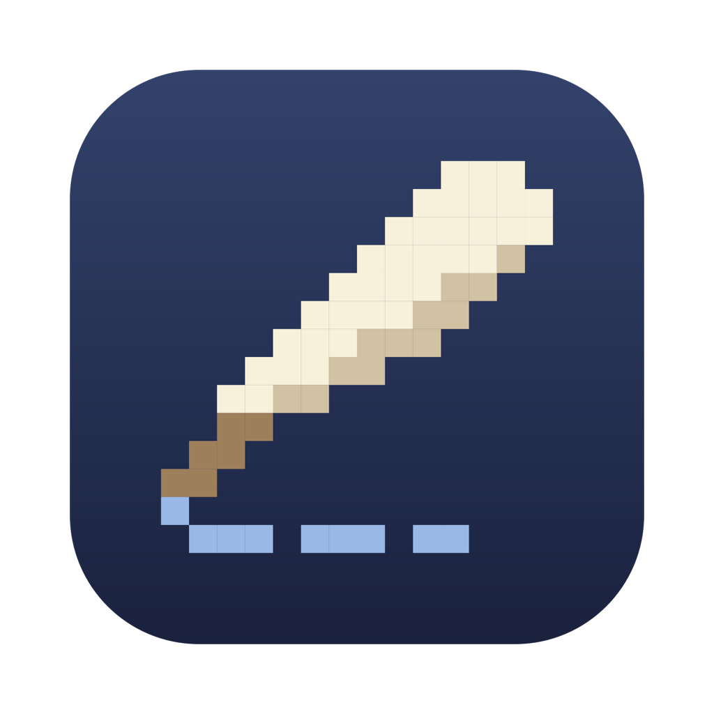

# Scribe

**당신의 AI 코딩 토큰을 고전 문학 집필로 — macOS 메뉴바에서.**

*Native Swift 6 · Zero External Dependencies · On-Device Token Tracker & Literary Simulation*

[](https://github.com/sangeui/Scribe/releases/latest)
[](https://github.com/sangeui/Scribe/releases/latest/download/Scribe.zip)
[](#설치)
[-0969da)](https://www.apple.com/macos/)
[](https://swift.org)
[](LICENSE)

**한국어** · [English](README.en.md)

[설치](#설치) · [핵심 특징](#왜-scribe인가요) · [지원 도구](#지원-도구) · [작동 방식](#어떻게-작동하나요) · [둘러보기](#둘러보기) · [데이터 소스 & 프라이버시](#데이터-소스) · [FAQ](#faq)

</div>

<br>

<div align="center">
<table>
<tr>
<td width="46%" align="center" valign="middle">
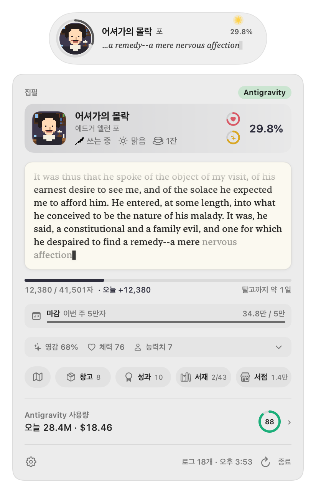
<br><sub><b>메뉴바 팝오버</b> — 통합 집필 카드 · 미니멀 원고 스트립 · 출판사 마감 · 오늘의 토큰 요약</sub>
</td>
<td width="54%" align="center" valign="middle">

<br><sub><b>바탕화면 상시 창 (Pill & Mini)</b> — 일출·일몰·달 위상·날씨와 오늘의 집필 진도가 살아 숨 쉬는 데스크탑 작업실</sub>
</td>
</tr>
</table>
</div>

**Scribe**는 매일 사용하는 AI 코딩 토큰(**Antigravity** · **Gemini CLI** · **Claude Code**)을 macOS 메뉴바와 바탕화면 속 작은 **고전 문학 작가의 작업실**로 바꿔주는 네이티브 앱입니다. 토큰을 쓰면 셰익스피어부터 괴테까지 대문호들이 프로젝트 구텐베르크(Project Gutenberg)의 실제 고전 원문을 한 글자씩 집필하고, 탈고한 책을 동네 서점에 납품해 베스트셀러로 키우며, 밤에는 작가 살롱에 모여 담소를 나눕니다. 그 아래에는 정밀한 로컬 사용량 트래커가 함께 돌아갑니다 — 오늘의 토큰·비용 환산·캐시 효율·최근 사용량 추이를 로컬 로그에서 직접 읽습니다.

> [!NOTE]
> **100% 온디바이스 로그 파싱 (`totalTokens` = input + output + cache, 로컬 날짜 기준)**
> 외부 사용량 CLI, 별도 API 키, 계정 로그인이 필요 없습니다. Scribe는 로컬 로그에서 토큰 수·시각·모델명만 읽기 전용으로 스캔하며, 프롬프트와 코드는 파싱하거나 Mac 밖으로 전송하지 않습니다.

---

## 설치

### Homebrew (권장)

```bash
brew install --cask sangeui/tap/scribe
```

설치가 끝나면 격리 속성이 자동으로 해제되고 **Scribe**가 바로 실행됩니다.

### 직접 다운로드

1. **[최신 Scribe.zip 다운로드](https://github.com/sangeui/Scribe/releases/latest/download/Scribe.zip)** 후 압축을 풀어 **`Scribe.app`**을 **`/Applications`** 폴더로 옮깁니다.
2. 최초 실행 시 한 번만 터미널에서 아래 명령어를 실행합니다:
   ```bash
   xattr -dr com.apple.quarantine /Applications/Scribe.app && open -a Scribe
   ```

---

## 왜 Scribe인가요

- **열어보는 게 기다려지는 토큰 사용량 트래커** — 코딩하며 태운 토큰이 숫자로만 사라지지 않고 *햄릿*, *크리스마스 캐럴*, *어셔가의 몰락*, *파우스트* 등 고전 문학의 실제 원문 타이핑으로 한 글자씩 쌓입니다.
- **오늘의 토큰 소비와 캐시 효율을 한눈에** — 브라우저 대시보드나 터미널 CLI를 따로 열지 않아도 메뉴바와 바탕화면 상시 창에서 **Antigravity · Gemini CLI · Claude Code**의 오늘 사용량, API 단가 환산 비용, 캐시 적중률, 시간대별·일별 추이를 즉시 확인합니다.
- **작가를 돌보고 서점을 운영하는 잔잔한 시뮬레이션** — 졸고 있는 작가에게 커피를 건네고, 탈고한 책을 서점 진열창에 올려 비평가 서평과 월요일 주간 정산서를 받아보세요.
- **가볍고 빠른 순수 macOS 네이티브 앱** — Electron이나 웹뷰 없이 순수 **Swift 6 (`AppKit` + `SwiftUI`)**와 외부 패키지 의존성 0개(`Package.swift`)로 작성되어 배터리와 메모리를 최소한으로 사용합니다.

---

## 지원 도구

| 도구 | 집계 범위 | 세부 정보 |
|---|---|---|
| **Antigravity** | 오늘 · 최근 세션 · 시간대별 · 최근 일별 추이 | 캐시 적중률 · 영감 게이지 · 모델별 토큰 및 API 단가 환산 |
| **Gemini CLI** | 오늘 · 최근 세션 · 시간대별 · 최근 일별 추이 | 세션별 입력 / 출력 / 캐시 / 사고(`thoughts`) 토큰 집계 |
| **Claude Code** | 오늘 · 최근 세션 · 시간대별 · 최근 일별 추이 | 모델별 토큰·비용 환산 및 공식 세션 / 주간 한도(%) |
| **통합 모드** | 위 모든 에이전트 합산 | 에이전트별 오늘 토큰 비중 막대 및 통합 집필 |

**설정(<kbd>⌘</kbd><kbd>,</kbd>) → 집필 / 기록 → `데이터 소스`**에서 언제든 공급원을 전환할 수 있으며, 소스를 바꿔도 지금까지 집필한 원고 글자 수는 그대로 보존됩니다.

---

## 어떻게 작동하나요

1. **평소처럼 코딩하세요.** Antigravity, Gemini CLI, Claude Code에서 태우는 토큰이 곧 작가의 집필 연료가 됩니다. 앱을 처음 켠 시점의 기존 토큰은 기준선으로 삼고, 그 뒤 새로 쓴 토큰부터 원문 글자로 변환합니다.
2. **실제 고전 원문이 한 글자씩 써집니다.** 구텐베르크 프로젝트의 퍼블릭 도메인 고전 원문이 단일 고압축 아카이브(`books.pak`)에 오프라인으로 내장되어 있으며, 집필 카드 하단의 한 줄 원고 스트립에서 실시간으로 타이핑됩니다. **서재**에서는 각 작품의 첫머리 발췌문을 미리 보거나 지금까지 쓴 원문을 책장 넘기듯 펼쳐 읽을 수 있습니다.
3. **돌발 상황을 돌봐 주세요.** 토큰을 쓰는 동안 작가가 책상에서 꾸벅 졸거나, 산책을 나가거나, 잉크가 바닥나거나, 첫 문장이 막혀 멈추기도 합니다. 토큰이 쌓일 때마다 얻는 커피·홍차·잉크병·호출 종·영감의 깃펜으로 작가를 다독여 즉시 복귀시키세요.
4. **탈고와 서점 납품.** 한 편을 끝까지 쓰면 탈고 카드와 함께 작가가 원고 뭉치를 들고 마을 길을 걸어 **동네 서점**에 납품합니다.
5. **동네 서점과 주간 마감.** 서점 진열창과 매대에 책을 배치하면 독자 서평, 신문 문화면 소개, 학교 단체 주문, 입소문이 일어나며 **초판 완판 → 재판 → 베스트셀러 → 밀리언셀러**로 성장합니다.
6. **작가 살롱과 다회차 집필.** 책을 탈고한 문호들은 밤마다 살롱에 모여 문학 담소를 나눕니다. 서재의 모든 작품을 탈고하면 다음 회차가 열리며 여러 작가가 동시에 집필합니다.

---

## 둘러보기

<table>
<tr>
<td width="48%" align="center">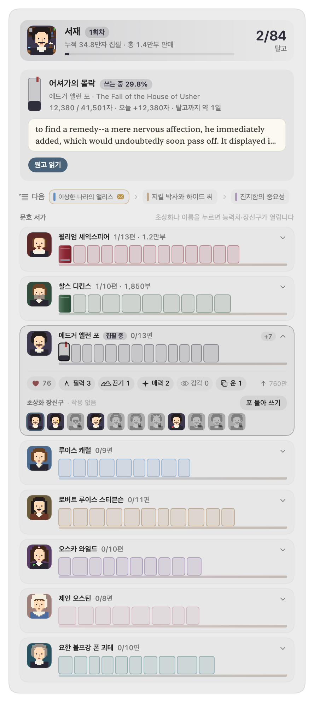</td>
<td width="52%" valign="middle">
<h3>대문호들과 고전 문학 서재</h3>
<b>윌리엄 셰익스피어 · 찰스 디킨스 · 에드거 앨런 포 · 루이스 캐럴 · 로버트 루이스 스티븐슨 · 오스카 와일드 · 제인 오스틴 · 요한 볼프강 폰 괴테</b> 등 시대를 대표하는 작가들의 고전 작품이 수록되어 있습니다. 작품별 첫머리 발췌문과 서평·판매량을 한눈에 살펴보고, 다음 집필 대기열을 정리하거나 작가 선반을 펼쳐 능력치와 장신구를 꾸밀 수 있습니다.
</td>
</tr>
<tr>
<td width="52%" valign="middle">
<h3>내 원고가 팔리는 동네 서점</h3>
탈고한 책은 동네 서점의 <b>진열창</b>과 <b>매대</b>에 올려 판매합니다. 품절되면 재판을 찍고, 광고를 집행하거나 서점 주인에게 진열을 맡길 수 있습니다. 매주 월요일에는 판매 부수·반품·놓친 손님과 주인의 한마디가 적힌 <b>주간 정산서</b>가 도착합니다.
</td>
<td width="48%" align="center">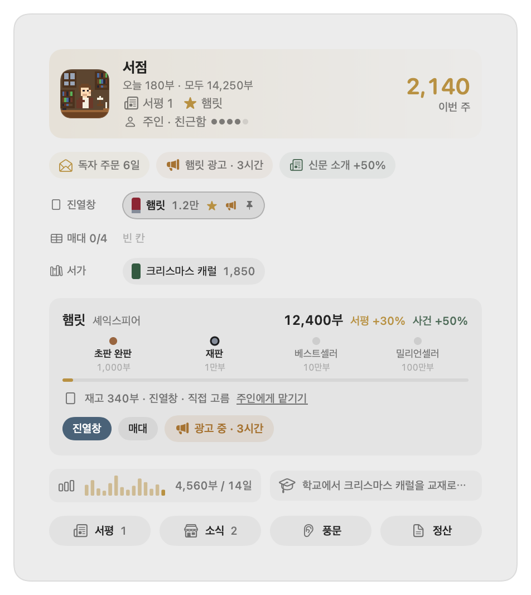</td>
</tr>
<tr>
<td width="48%" align="center">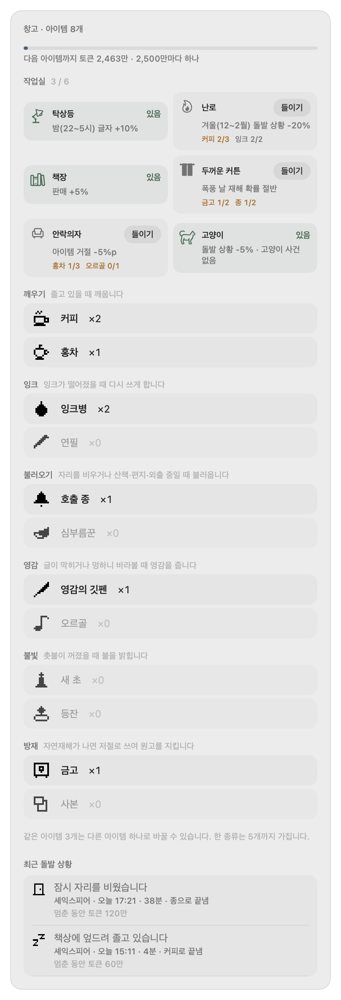</td>
<td width="52%" valign="middle">
<h3>작업실 가구와 회복 아이템</h3>
토큰을 쓰며 얻는 아이템으로 졸음·잉크 고갈·외출·슬럼프·정전을 해결하고, 금고와 사본으로 자연재해(쥐·홍수·화재·도둑)로부터 원고를 지킵니다. 남는 아이템을 모으면 작업실에 <b>탁상등 · 난로 · 책장 · 두꺼운 커튼 · 안락의자 · 고양이</b> 등의 가구를 들여 영구 효과를 얻습니다.
</td>
</tr>
<tr>
<td width="52%" valign="middle">
<h3>방향키로 걸어 다니는 마을과 독자들</h3>
팝오버에서 지도 버튼을 누르거나 방향키(<kbd>←</kbd><kbd>↑</kbd><kbd>↓</kbd><kbd>→</kbd>)를 누르면 픽셀 마을이 열립니다. 작업실·창고·서점·살롱 사이를 걸어 다니며 길에서 마주친 독자에게 책을 추천하고, 땅에 떨어진 아이템을 주울 수 있습니다.
</td>
<td width="48%" align="center">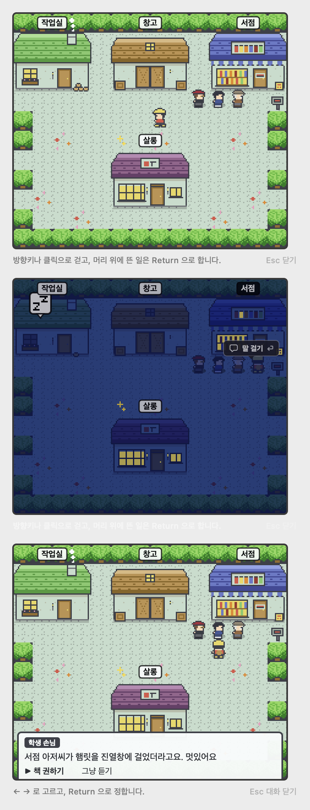</td>
</tr>
<tr>
<td width="48%" align="center">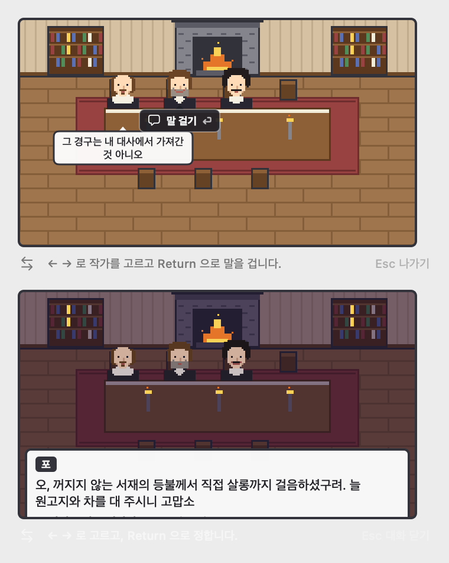</td>
<td width="52%" valign="middle">
<h3>문호들이 모이는 작가 살롱</h3>
책을 탈고한 작가들은 마을의 <b>살롱</b>에 머뭅니다. 살롱에 들어가 동료 문호들과 시대를 넘나드는 대화를 나누거나, 마음에 드는 작가를 작업실의 손님 작가로 초대해 함께 집필할 수 있습니다.
</td>
</tr>
<tr>
<td width="52%" valign="middle">
<h3>에이전트별 토큰 사용량 대시보드</h3>
<b>Antigravity · Gemini</b>와 <b>Claude Code</b>의 오늘 토큰, API 단가 환산 비용, 캐시 적중률, 영감 게이지, 오늘 시간대별 막대 차트, 최근 일별 추이, 모델별 세부 내역을 한 화면에서 확인합니다.
</td>
<td width="48%" align="center">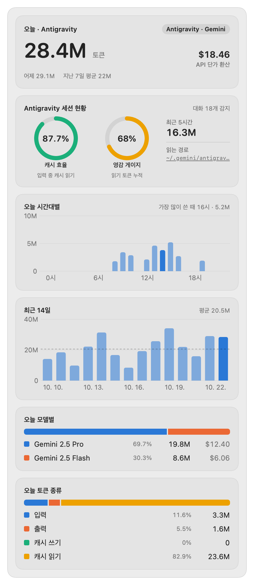</td>
</tr>
<tr>
<td width="48%" align="center">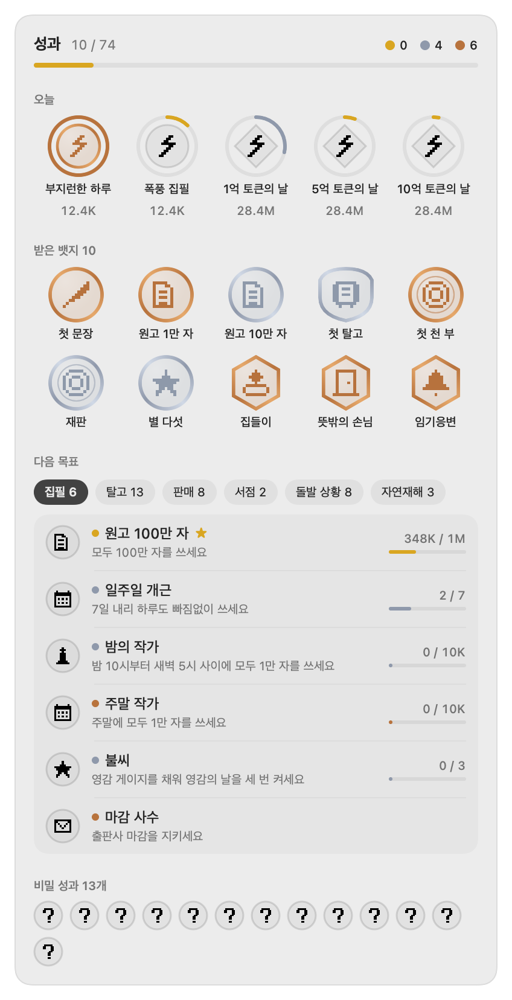</td>
<td width="52%" valign="middle">
<h3>후원자 칭호와 훈장 진열대</h3>
일일 토큰 목표(동·은·금 메달), 집필·탈고·판매·서점·돌발 상황·자연재해·비밀 성과까지 다양한 업적 배지가 준비되어 있습니다. 성과를 달성하면 문호들을 후원하는 사용자를 기리는 <b>후원자 칭호</b>가 해금되어 살롱과 마을에서 그 칭호로 불리며, 받은 뱃지를 <b>훈장 진열대</b>에 장식해 집필 속도·아이템 토큰·돌발 상황 단축·거절 확률 감소 등 분야별 진열 효과를 직접 조합할 수 있습니다.
</td>
</tr>
<tr>
<td width="52%" valign="middle">
<h3>다채로운 표정과 수집 장신구</h3>
작가마다 고유한 돌발 상황 표정(졸음, 찻잔, 열쇠 찾기, 거울 보기 등)이 그려지며, 특정 성과를 달성하면 <b>외알 안경 · 선글라스 · 파이프 · 월계관 · 왕관 · 장미 · 나비넥타이</b> 등의 장신구를 해금해 초상화에 씌울 수 있습니다.
</td>
<td width="48%" align="center">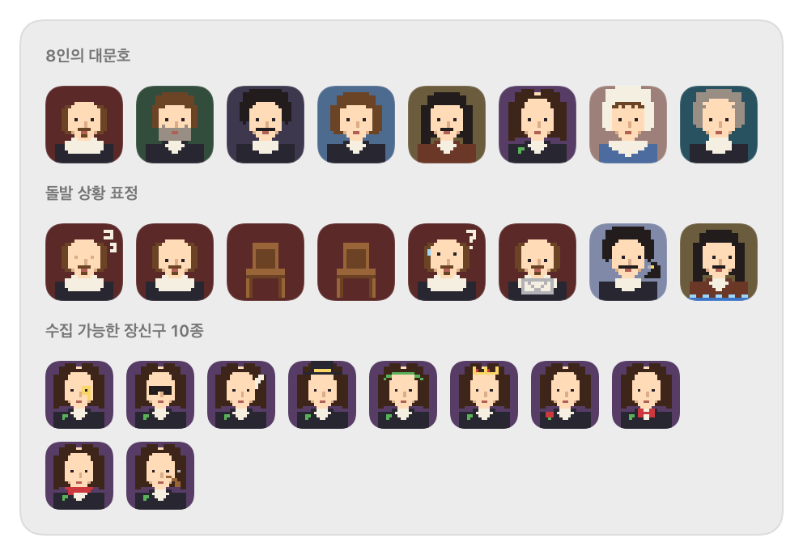</td>
</tr>
</table>

<div align="center">
<h3>일출과 일몰을 따라 물드는 시간의 빛</h3>
<p>바탕화면 상시 창은 현재 계절의 일출·일몰 시각에 맞춰 새벽·아침·한낮·노을·밤하늘의 색조로 서서히 물들며, 구석의 해와 달(실제 위상), 그리고 비·안개·눈·폭풍 등 오늘의 날씨 효과가 함께 반영됩니다.</p>
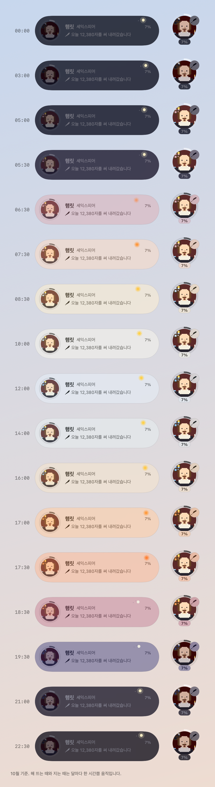
</div>

### 이 밖에도

- **출판사 주간 마감** — 매주 출판사에서 목표 글자 수나 토큰 마감을 제안합니다. 기한까지 완수하면 보너스 아이템과 서점 판매량 부스트를 받습니다.
- **집필 중 딜레마와 내기** — 편집자의 제목 변경 요청, 연재 제안, 길고양이 입양 같은 선택지(`Dilemma`)와 손님 작가의 제한 시간 집필 내기(`Bet`)가 찾아옵니다.
- **영감 게이지와 점화** — 입력·캐시 읽기 토큰이 쌓이면 영감 게이지가 차오르고, **영감 켜기**를 누르면 일정 시간 동안 집필 속도가 크게 오릅니다.
- **방해 금지 시간대** — 집중하고 싶은 시간대를 설정하면 알림을 보류했다가 팝오버에 모아 보여줍니다.

---

## 데이터 소스

| 소스 경로 | 용도 | 비고 |
|---|---|---|
| `~/.gemini/antigravity/brain/**/.system_generated/logs/transcript.jsonl`<br>`~/.gemini/antigravity/brain/**/transcript.jsonl` | Antigravity 일별/시간대별/모델별 토큰 | 직접 읽기 전용 스캔; 스텝 인덱스 중복 제거; 파일 수정 시각 증분 캐시 |
| `~/.gemini/tmp/**/chats/*.json` | Gemini CLI 일별/시간대별/모델별 토큰 | 메시지별 `tokens`(`input`, `output`, `cached`, `thoughts`, `tool`) 읽기 전용 파싱 |
| `~/.claude/projects/**/*.jsonl` | Claude Code 일별/시간대별/모델별 토큰 | `assistant` 응답의 `usage` 블록 직접 파싱; 메시지 ID 중복 제거; 증분 캐시 |
| `~/Library/Application Support/Scribe/writing.json` | 집필 진행률, 서재, 서점, 가방, 성과 로컬 저장 | 온디바이스 JSON 파일; 설정에서 언제든 초기화 가능 |
| Keychain (`Claude Code-credentials`) / `~/.claude/.credentials.json` → `api.anthropic.com` | Claude Code 공식 세션/주간 한도 % | `Claude Code` 또는 `통합` 소스 사용 시에만 조회; `Antigravity` 단독 모드에서는 호출하지 않음 |

### 프라이버시 & 권한

- **온디바이스 우선 (On-device first).** 토큰 사용량은 로컬 Antigravity, Gemini CLI, Claude Code 로그 파일에서 **숫자(`usage` / `tokens`)와 시각, 모델 이름만** 읽습니다. 사용자가 작성한 프롬프트 본문이나 코드는 파싱하지 않으며, 어떤 데이터도 외부 서버로 업로드하지 않습니다.
- **외부 네트워크 요청 최소화.** `Antigravity` 데이터 소스 모드에서는 외부 네트워크 요청을 전혀 하지 않는 **100% 오프라인**으로 동작합니다. `Claude Code` 모드에서만 공식 세션/주간 한도 퍼센트를 표시하기 위해 `api.anthropic.com/api/oauth/usage`를 조회합니다.
- **Keychain (선택).** Claude Code 한도 조회 시 `~/.claude/.credentials.json` 파일이 있으면 우선 읽고, 없을 때만 Keychain 자격증명을 참조합니다.

---

## FAQ

<details>
<summary><b>앱을 설치하기 전에 이미 사용한 토큰도 소급되어 집필되나요?</b></summary>
<br>
대시보드 통계(오늘 토큰, 일별 차트 등)에는 기존 로컬 로그가 모두 표시되지만, <b>문학 작품 집필</b>은 앱을 처음 실행한 시점의 누적 토큰을 기준선(Baseline)으로 삼고 그 이후 새로 태운 토큰부터 한 글자씩 집필합니다. 덕분에 처음부터 작가와 함께 작품을 써 내려가는 재미를 온전히 느낄 수 있습니다.
</details>

<details>
<summary><b>데이터 소스를 Antigravity에서 Claude Code나 통합 모드로 바꾸면 집필 중인 원고가 초기화되나요?</b></summary>
<br>
초기화되지 않습니다. 데이터 소스를 전환하면 새 소스의 현재 토큰을 새로운 기준선으로 자동 보정하므로, 지금까지 집필한 글자 수와 탈고한 책·서점·아이템·성과는 모두 그대로 유지됩니다.
</details>

<details>
<summary><b>메뉴바에 아이콘이 보이지 않을 때는 어떻게 하나요?</b></summary>
<br>
MacBook 노치(Notch)나 메뉴바 아이콘 과밀로 가려진 경우, <kbd>⌘</kbd>(Command) 키를 누른 채 다른 메뉴바 아이콘을 드래그해 순서를 조정하거나 팝오버 상단에서 <b>상시 창(알약 / 미니)</b>을 켜 바탕화면에 직접 띄워 둘 수 있습니다.
</details>

---

## 소스 빌드 (Development)

외부 패키지 의존성이 없는 순수 Swift Package 프로젝트입니다(`Swift 6.0`, `macOS 14.0+`).

```bash
swift build                      # 디버그 빌드
./scripts/test-gate.sh           # 회귀 셀프테스트 게이트(--selftest) 실행
./scripts/create-signing-cert.sh # (선택) 로컬 자체 서명 인증서 생성
./scripts/build-app.sh           # Universal 릴리스 → build/Scribe.app & build/Scribe.zip
```

---

## 라이선스

**MIT** — [LICENSE](LICENSE) 참고. 앱에 수록된 고전 문학 원문은 모두 [Project Gutenberg](https://www.gutenberg.org/)의 퍼블릭 도메인(저작권 만료) 작품을 사용합니다.
