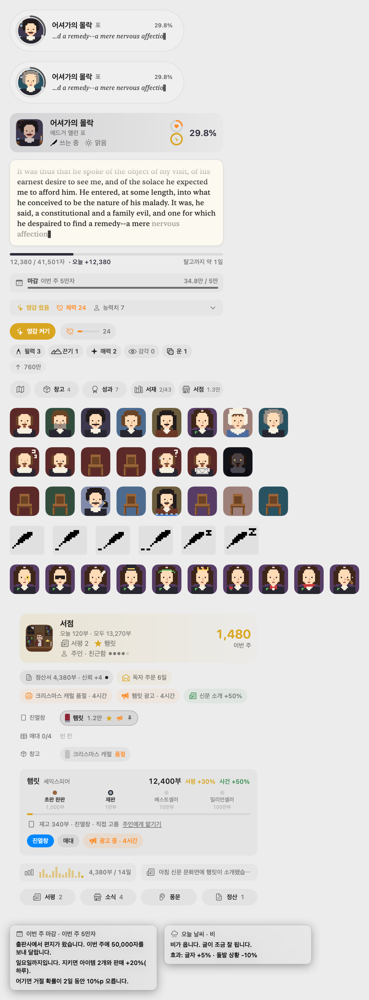

<div align="center">


# Scribe

**당신이 태운 AI 코딩 토큰으로 셰익스피어부터 괴테까지 43편의 고전을 한 글자씩 집필하는 macOS 메뉴바 앱**

[](https://github.com/sangeui/Scribe/releases/latest)
[](https://github.com/sangeui/Scribe/releases/latest/download/Scribe.zip)
[-000000?logo=apple)](https://github.com/sangeui/Scribe/releases/latest)
[](https://swift.org)
[](#지원하는-ai-에이전트-및-데이터-소스-설정)
[](LICENSE)

[**다운로드 및 설치**](#-다운로드-및-설치) · [**지원 에이전트 설정**](#-지원하는-ai-에이전트-및-데이터-소스-설정) · [**화면 미리보기**](#-화면-미리보기) · [**주요 시스템**](#-주요-시스템) · [**직접 빌드하기**](#-소스에서-직접-빌드하기)

</div>

---

**Scribe**는 **Antigravity · Gemini CLI**와 **Claude Code**가 로컬에 남기는 토큰 사용 기록을 읽어, macOS 메뉴바와 바탕화면 한구석에서 작은 픽셀 작가가 고전 문학 원문을 실시간으로 한 글자씩 써 내려가게 만드는 집필 시뮬레이터입니다.

별도의 API 키 입력이나 로그인, 외부 서버 전송 없이 **100% 로컬 파일만 읽어서 작동**합니다.

<p align="center">
  
</p>

---

## 📥 다운로드 및 설치

> **요구 사항**: macOS 14.0 (Sonoma) 이상 · Apple Silicon (`arm64`) 및 Intel (`x86_64`) Universal 바이너리 지원

### 방법 1. Homebrew로 설치 (권장)

터미널에서 아래 명령어 한 줄을 실행하면 설치와 macOS Gatekeeper 격리 해제가 한 번에 완료됩니다.

```bash
brew tap sangeui/scribe https://github.com/sangeui/Scribe
brew install --cask sangeui/scribe/scribe
```

설치 후 Spotlight(`⌘Space`)에서 **Scribe**를 검색하거나 `/Applications/Scribe.app`을 실행하세요.

<details>
<summary><b>업데이트 및 삭제 명령어</b></summary>

```bash
# 최신 버전으로 업데이트
brew update && brew upgrade --cask sangeui/scribe/scribe

# 앱 삭제
brew uninstall --cask scribe
```
</details>

---

### 방법 2. 직접 다운로드 (`Scribe.zip`)

Homebrew를 사용하지 않는다면 GitHub Releases에서 압축 파일을 직접 내려받아 바로 사용할 수 있습니다.

1. **[📦 Scribe.zip 최신 버전 바로 다운로드](https://github.com/sangeui/Scribe/releases/latest/download/Scribe.zip)** 를 클릭해 내려받습니다. (또는 [Releases 페이지](https://github.com/sangeui/Scribe/releases/latest)에서 확인)
2. 압축을 풀고 **`Scribe.app`** 을 **`응용 프로그램(/Applications)`** 폴더로 이동합니다.
3. **최초 실행 시 macOS 보안 경고 해제 (최초 1회)**:
   이 앱은 유료 Apple Developer ID 공증 없이 배포되므로, 처음 더블클릭하면 macOS가 *"손상되었기 때문에 열 수 없습니다"* 또는 *"개발자를 확인할 수 없습니다"* 경고를 표시할 수 있습니다. 아래 두 가지 방법 중 하나로 열면 이후부터는 경고 없이 실행됩니다.

   - **터미널 명령어로 즉시 해제 및 실행 (가장 빠름)**:
     ```bash
     xattr -dr com.apple.quarantine /Applications/Scribe.app
     open -a Scribe
     ```
   - **Finder에서 우클릭으로 열기**:
     `/Applications/Scribe.app` 아이콘을 **우클릭(Control + 클릭) → 열기(Open)** 를 선택한 뒤, 대화상자에서 **열기**를 클릭합니다.

---

## 🔌 지원하는 AI 에이전트 및 데이터 소스 설정

Scribe는 다음 AI 코딩 에이전트의 로컬 토큰 사용량을 자동으로 읽어옵니다.

| 데이터 소스 | 읽어오는 로컬 경로 | 제공 정보 |
| :--- | :--- | :--- |
| **Antigravity · Gemini** | `~/.gemini/antigravity/brain`<br>`~/.gemini/tmp` | 오늘/14일/시간대별 토큰, 캐시 효율, 영감 게이지, 감지된 대화 수 |
| **Claude Code** | `~/.claude/projects` | 오늘/14일/시간대별 토큰, 모델별 비용 환산, 5시간/7일 세션 한도 |
| **통합 (모두 합산)** | 위 두 경로 모두 합산 | Antigravity · Gemini와 Claude Code에서 태운 모든 토큰을 합산하여 집필 |

### 데이터 소스 변경 방법

1. 메뉴바에서 **Scribe 아이콘(깃펜)** 을 클릭하고 하단의 **톱니바퀴(`⚙`)** 버튼을 누르거나 단축키 **`⌘,`** 를 눌러 **설정** 창을 엽니다.
2. **집필** 또는 **기록** 탭 맨 위에 있는 **`데이터 소스`** 섹션에서 원하는 에이전트(**Antigravity · Gemini** / **Claude Code** / **통합**)를 직접 클릭해 선택합니다.
3. 각 소스 카드에서 감지된 로그 파일 수와 오늘 사용한 토큰 수를 실시간으로 확인할 수 있습니다.

---

## 🖼 화면 미리보기

### 1. 원문 집필 · 문호 초상화 · 동네 서점

코딩 에이전트가 토큰을 소비할 때마다 프로젝트 구텐베르크(Project Gutenberg)에 수록된 실제 고전 원문이 한 글자씩 타이핑됩니다.

<p align="center">
  
</p>

### 2. 마을 산책과 작가 살롱

책을 탈고하면 작가가 원고 뭉치를 들고 마을 길을 걸어 서점에 납품합니다. 밤이 되면 탈고한 작가들이 살롱에 모여 문학 담소를 나눕니다.

<table>
  <tr>
    <td align="center" width="55%">
      <br/>
      <sub><b>마을 (낮 · 밤 · 독자와의 대화)</b></sub>
    </td>
    <td align="center" width="45%">
      <br/>
      <sub><b>작가 살롱 (낮 · 밤의 문학 모임)</b></sub>
    </td>
  </tr>
</table>

### 3. 하루의 시간과 계절을 담는 상시 창

바탕화면에 띄워 두는 상시 창(알약 · 미니 스타일)은 현재 시각의 일출·일몰에 맞춰 새벽, 아침, 한낮, 노을, 밤하늘의 색조로 서서히 물듭니다.

<p align="center">
  
</p>

---

## 📖 주요 시스템

### ✍️ 토큰을 원고로 바꾸는 집필 규칙
- **100만 토큰 = 1,000자**: 앱을 처음 켠 시점의 기존 토큰은 기준선(0자)으로 삼고, 그 이후 새로 태운 토큰부터 원문 글자로 변환합니다.
- **8명의 대문호, 43편의 고전 (총 1,412만 자)**:
  - **윌리엄 셰익스피어** (7편): *햄릿, 맥베스, 로미오와 줄리엣, 리어왕, 오셀로, 한여름 밤의 꿈, 템페스트*
  - **찰스 디킨스** (4편): *크리스마스 캐럴, 올리버 트위스트, 두 도시 이야기, 위대한 유산*
  - **에드거 앨런 포** (4편): *검은 고양이, 어셔가의 몰락, 갈가마귀, 붉은 죽음의 가면*
  - **루이스 캐럴** (4편): *이상한 나라의 앨리스, 거울 나라의 앨리스, 스나크 사냥, 실비와 브루노*
  - **로버트 루이스 스티븐슨** (4편): *지킬 박사와 하이드 씨, 보물섬, 유괴, 자살 클럽*
  - **오스카 와일드** (5편): *행복한 왕자, 도리안 그레이의 초상, 진지함의 중요성, 캔터빌의 유령, 살로메*
  - **제인 오스틴** (5편): *오만과 편견, 이성과 감성, 엠마, 노생거 사원, 설득*
  - **요한 볼프강 폰 괴테** (10편): *젊은 베르테르의 슬픔, 파우스트 1·2부, 헤르만과 도로테아, 빌헬름 마이스터의 수업시대 등*
- **회차(New Game+)와 다중 집필**: 43편을 모두 탈고하면 2회차가 열리며 동시에 두 편, 3회차에는 세 편을 함께 집필합니다.

### ☕ 돌발 상황과 12종의 회복 아이템
작가는 토큰 100만 개마다 일정 확률로 낮잠을 자거나, 산책을 나가거나, 잉크를 쏟거나, 슬럼프에 빠집니다. **2,500만 토큰마다 1개씩** 얻는 아이템으로 작가를 다독여 즉시 복귀시킬 수 있습니다.

| 상태 | 현상 | 해결 아이템 |
| :--- | :--- | :--- |
| **졸음** | 책상에 엎드려 잠듦 | ☕ **커피**, 🍵 **홍차** |
| **잉크 고갈** | 잉크가 바닥나 펜이 멈춤 | 🖋 **잉크병**, ✏️ **연필** |
| **자리 비움** | 산책·편지·외출로 자리를 비움 | 🔔 **호출 종**, 🏃 **심부름꾼** |
| **막힘** | 첫 줄이 안 풀려 멍하니 바라봄 | 🪶 **영감의 깃펜**, 🎵 **오르골** |
| **불 꺼짐** | 촛불이 꺼져 원고가 안 보임 | 🕯 **새 초**, 🏮 **등잔** |
| **자연재해** | 쥐·홍수·화재·도둑으로 원고 손실 위험 | 🗄 **금고**, 📄 **사본** (자동 방어) |

남는 아이템을 모으면 작업실에 **탁상등, 난로, 책장, 두꺼운 커튼, 안락의자, 고양이** 등 6종의 가구를 들여 영구 버프를 얻을 수 있습니다.

### 🏪 동네 서점과 출판사 마감
- 탈고한 책은 **동네 서점**의 진열창과 매대에 올려 판매합니다.
- 독자 서평, 신문 문화면 소개, 입소문, 광고 캠페인에 따라 하루 판매량이 달라지며 **초판 완판(1천 부) → 재판(1만 부) → 베스트셀러(10만 부) → 밀리언셀러(100만 부)** 단계를 밟아 나갑니다.
- 매주 출판사에서 보내오는 **주간 마감**을 지키면 보너스 아이템과 판매량 부스트를 받습니다.

### 🏅 74종의 성과와 작가 능력치
- 일일 토큰 목표, 탈고, 누적 부수, 돌발 상황 대처, 그리고 조건이 숨겨진 **비밀 성과 13종**까지 총 74종의 배지가 준비되어 있습니다.
- 성과를 달성할 때마다 **필력 · 끈기 · 매력 · 감각 · 운** 능력치 점수를 얻어 작가의 집필 속도와 판매량, 아이템 획득률을 높일 수 있습니다.

---

## 🛠 소스에서 직접 빌드하기

Swift 6.0 이상(Xcode 16 이상 또는 Command Line Tools)이 설치된 macOS에서 바로 빌드할 수 있습니다.

```bash
# 1. 저장소 클론
git clone https://github.com/sangeui/Scribe.git
cd Scribe

# 2. (선택) 재빌드 시 macOS 권한 설정이 초기화되지 않도록 로컬 자체 서명 인증서 생성
./scripts/create-signing-cert.sh

# 3. Universal 앱 번들(build/Scribe.app) 및 배포용 압축본(build/Scribe.zip) 빌드
./scripts/build-app.sh

# 4. 응용 프로그램 폴더에 설치 및 실행
cp -R build/Scribe.app /Applications/
open -a Scribe
```

### 테스트 및 미리보기 렌더링 명령어

```bash
# 전체 회귀 테스트 게이트 실행 (65개 검증 항목)
./scripts/test-gate.sh

# 각 화면 PNG 오프스크린 렌더링
./build/Scribe.app/Contents/MacOS/Scribe --writing assets/writing.png --review --deadline --stats
./build/Scribe.app/Contents/MacOS/Scribe --styles assets/styles.png
./build/Scribe.app/Contents/MacOS/Scribe --village assets/village.png
./build/Scribe.app/Contents/MacOS/Scribe --salon assets/salon.png
./build/Scribe.app/Contents/MacOS/Scribe --hours assets/hours.png
```

---

## 📄 라이선스

이 프로젝트는 [MIT License](LICENSE)에 따라 배포됩니다. 수록된 43편의 고전 문학 원문은 모두 [Project Gutenberg](https://www.gutenberg.org)의 퍼블릭 도메인(저작권 만료) 작품을 사용합니다.
